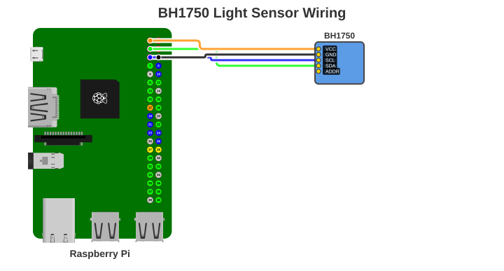
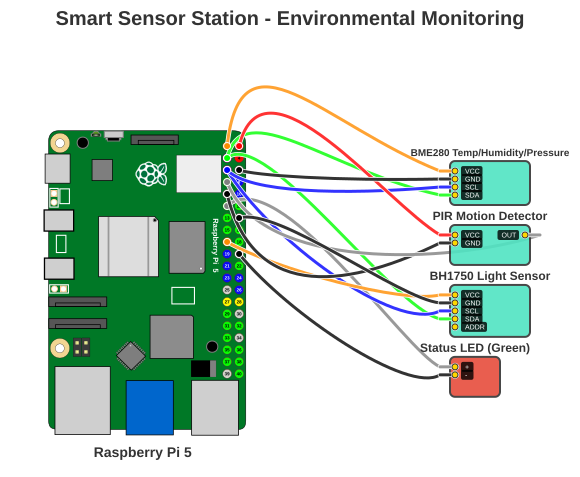
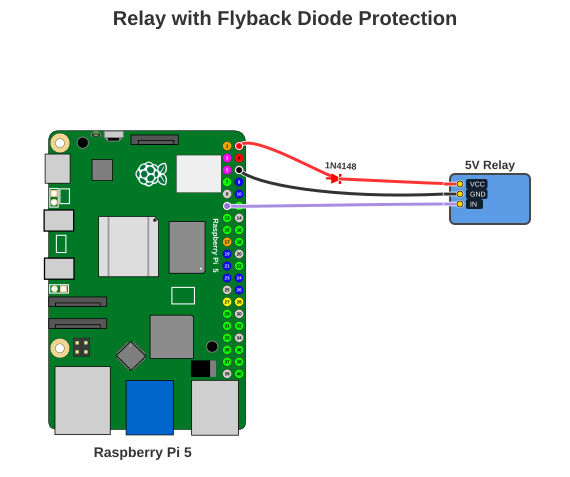
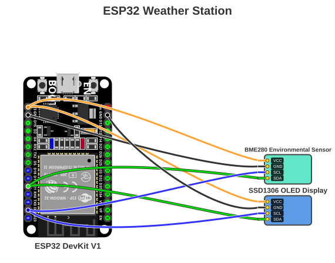
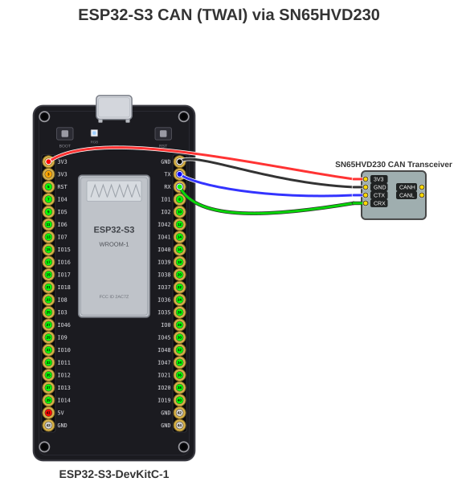
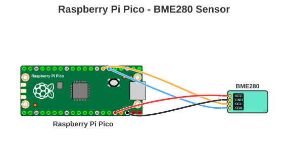
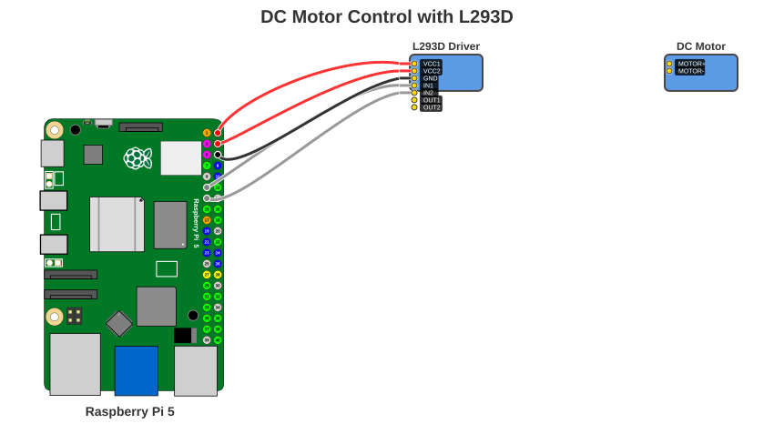
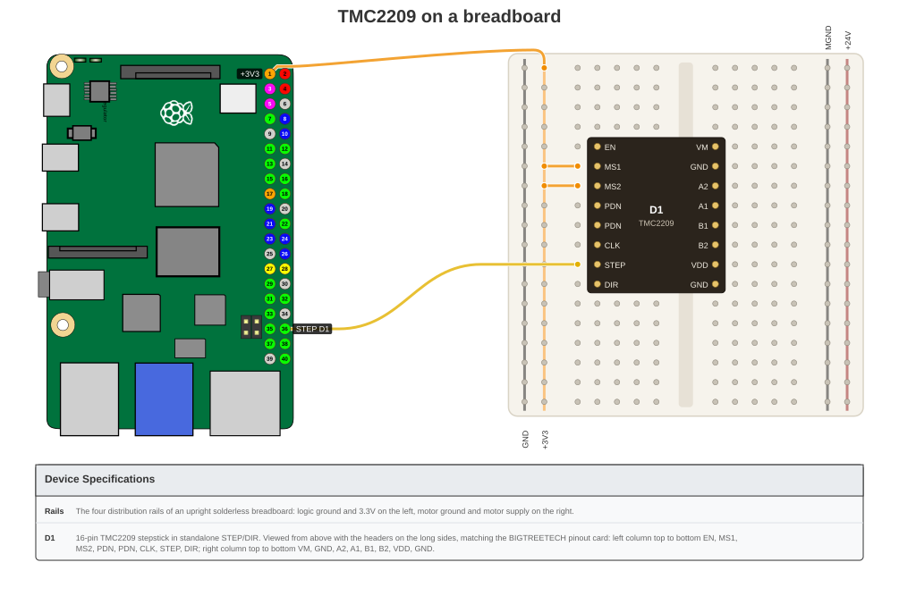
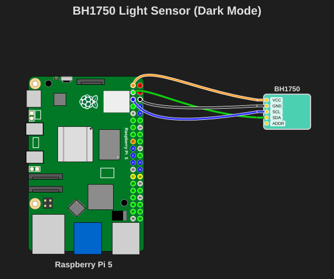

# Examples

Start with a diagram that resembles your project, then open its full example for
the YAML configuration and command to generate it.

## Diagram gallery

<div class="grid cards" markdown>

-   [{ loading=lazy }](examples-raspberry-pi.md#bh1750-light-sensor)

    ### [I²C light sensor](examples-raspberry-pi.md#bh1750-light-sensor)

    Raspberry Pi 5 · BH1750 · I²C wiring

-   [{ loading=lazy }](examples-raspberry-pi.md#multi-device-setup)

    ### [Multi-device sensor station](examples-raspberry-pi.md#multi-device-setup)

    Raspberry Pi 5 · shared buses · multiple devices

-   [{ loading=lazy }](examples-components.md#relay-with-flyback-diode)

    ### [Inline components](examples-components.md#relay-with-flyback-diode)

    Raspberry Pi 5 · resistor · capacitor · diode

-   [{ loading=lazy }](examples-esp.md#esp32-weather-station)

    ### [ESP32 weather station](examples-esp.md#esp32-weather-station)

    ESP32 DevKit V1 · BME280 · OLED · shared I²C

-   [{ loading=lazy }](examples-esp.md#esp32-s3-can-twai-via-sn65hvd230)

    ### [ESP32-S3 CAN bus](examples-esp.md#esp32-s3-can-twai-via-sn65hvd230)

    ESP32-S3 · TWAI · CAN transceiver

-   [{ loading=lazy }](examples-pico.md#pico-bme280-sensor)

    ### [Pico sensor](examples-pico.md#pico-bme280-sensor)

    Raspberry Pi Pico · dual-sided header · I²C

-   [{ loading=lazy }](examples-multi-tier.md#motor-control-with-l293d)

    ### [Motor control chain](examples-multi-tier.md#motor-control-with-l293d)

    Raspberry Pi 5 · driver · device-to-device wiring

-   [{ loading=lazy }](../features/breadboard-layout.md)

    ### [Breadboard layout](../features/breadboard-layout.md)

    Raspberry Pi 4 or 5 · TMC2209 · experimental

-   [{ loading=lazy }](examples-raspberry-pi.md#bh1750-sensor-dark-mode)

    ### [Dark-mode output](examples-raspberry-pi.md#bh1750-sensor-dark-mode)

    Raspberry Pi 5 · dark theme · presentation-ready

</div>

## Browse by board or layout

<div class="grid cards" markdown>

-   ### [Raspberry Pi](examples-raspberry-pi.md)

    Sensors, LEDs, shared buses, specifications, and dark mode.

-   ### [Inline components](examples-components.md)

    Resistors, capacitors, and diodes rendered directly on wires.

-   ### [Raspberry Pi Pico](examples-pico.md)

    Pico's dual-sided header with sensors, LEDs, and specifications.

-   ### [ESP32 / ESP8266](examples-esp.md)

    ESP32, ESP32-S3, NodeMCU, and Wemos D1 Mini projects.

-   ### [Multi-tier connections](examples-multi-tier.md)

    Drivers, relays, motors, and device-to-device power chains.

-   ### [Breadboard layout](../features/breadboard-layout.md)

    A physical TMC2209 stepstick layout on a solderless breadboard.

</div>

## Find an example by capability

| Need | Start with |
| ---- | ---------- |
| I²C sensor | [BH1750 light sensor](examples-raspberry-pi.md#bh1750-light-sensor) or [Pico BME280](examples-pico.md#pico-bme280-sensor) |
| Shared I²C bus | [ESP32 weather station](examples-esp.md#esp32-weather-station) |
| Inline resistor, capacitor, or diode | [Inline components](examples-components.md) |
| Multiple devices | [Multi-device setup](examples-raspberry-pi.md#multi-device-setup) |
| Device-to-device wiring | [Motor control chain](examples-multi-tier.md#motor-control-with-l293d) |
| Smart GND or power distribution | [ESP8266 LEDs](examples-esp.md#esp8266-nodemcu-led-example) |
| Specifications table | [Raspberry Pi specifications](examples-raspberry-pi.md#device-specifications-table) |
| Dark output | [BH1750 dark mode](examples-raspberry-pi.md#bh1750-sensor-dark-mode) |

??? example "Watch PinViz generate diagrams"

    ### ESP32 weather station

    <p align="center">
      
    </p>

    ### Custom device creation

    <p align="center">
      
    </p>

## Try a built-in example

```bash
# List all available built-in examples
pinviz list

# Generate a BH1750 light-sensor diagram
pinviz example bh1750 -o bh1750.svg

# Generate an ESP32 weather-station diagram
pinviz example esp32_weather -o esp32_weather.svg
```

All YAML example files are in the [`examples/`](https://github.com/nordstad/PinViz/tree/main/examples)
directory. Generated SVGs are in the [`images/`](https://github.com/nordstad/PinViz/tree/main/images)
directory.

## Contributing examples

Have a useful diagram to share? Submit a pull request to the
[`examples/`](https://github.com/nordstad/PinViz/tree/main/examples) directory with:

1. A well-commented YAML configuration file
2. A description of what the example demonstrates
3. The rendered SVG diagram

## Next steps

- [YAML configuration guide](yaml-config.md) — all config options
- [CLI usage](cli.md) — all commands and flags
- [Validation](../validation.md) — catch wiring errors
- [Multi-level connections](../multi-level-connections.md) — device-to-device wiring guide
