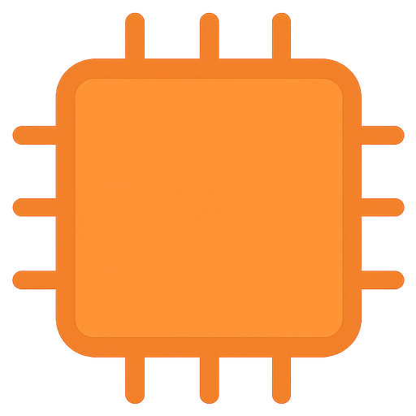
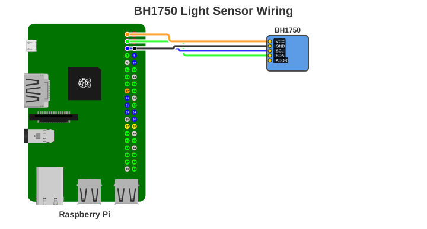
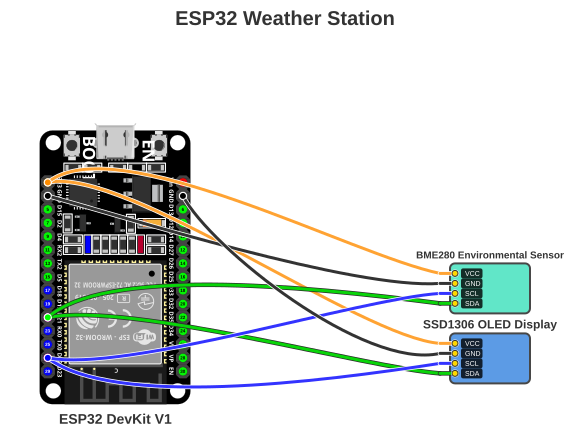
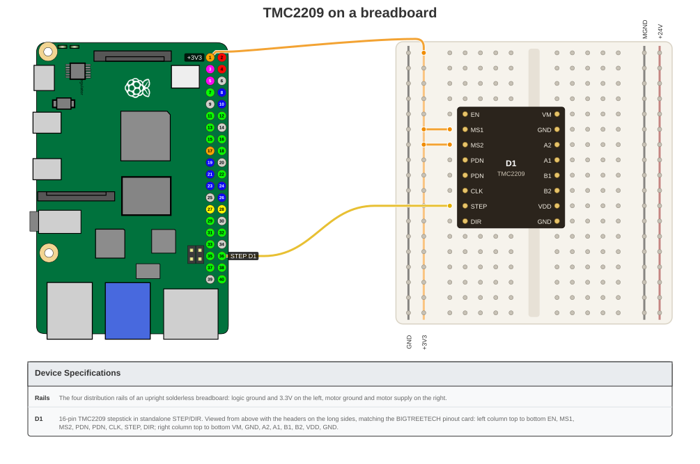

# PinViz

<p align="center">
  
</p>

<p align="center">
  <a href="https://github.com/nordstad/PinViz/actions/workflows/ci.yml"></a>
  <a href="https://nordstad.github.io/PinViz/"></a>
  <a href="https://opensource.org/licenses/MIT"></a>
  <a href="https://www.python.org/downloads/"></a>
  <a href="https://pypi.org/project/pinviz/"></a>
  <a href="https://pepy.tech/projects/pinviz"></a>
</p>

Programmatically generate beautiful GPIO connection diagrams for Raspberry Pi and ESP32/ESP8266 boards in SVG format.

PinViz makes it easy to create clear, professional wiring diagrams for your microcontroller projects. Define your connections using simple YAML/JSON files or Python code, and automatically generate publication-ready SVG diagrams.

## See It In Action

### Quick Demo - CLI Usage

<p align="center">
  
</p>

## Features

- **Declarative Configuration**: Define diagrams using YAML or JSON
- **Programmatic API**: Create diagrams with Python code
- **Automatic Wire Routing**: Smart wire routing with configurable styles (orthogonal, curved, mixed)
- **Inline Components**: Add resistors, capacitors, and diodes directly on wires
- **Color-Coded Wires**: Automatic color assignment based on pin function (I2C, SPI, power, ground, etc.)
- **Built-in Templates**: Pre-configured boards (Raspberry Pi 4, 5, Pico, ESP32, ESP8266) and common devices (BH1750, IR LED rings, etc.)
- **Hardware Validation**: Catch wiring mistakes before building (pin conflicts, voltage mismatches, I2C address collisions)
- **MCP Server**: Generate diagrams using natural language with Claude (via Model Context Protocol)
- **Structured Logging**: Professional logging with contextual information using structlog
- **SVG Output**: Scalable, high-quality vector graphics

## Example Diagrams

Browse complete, runnable configurations by board, layout, and capability in the
[diagram gallery](guide/examples.md).

<div class="grid cards" markdown>

-   [{ loading=lazy }](guide/examples-raspberry-pi.md#bh1750-light-sensor)

    ### [I²C light sensor](guide/examples-raspberry-pi.md#bh1750-light-sensor)

    Raspberry Pi 5 · BH1750 · I²C wiring

-   [{ loading=lazy }](guide/examples-esp.md#esp32-weather-station)

    ### [ESP32 weather station](guide/examples-esp.md#esp32-weather-station)

    ESP32 DevKit V1 · BME280 · OLED · shared I²C

-   [{ loading=lazy }](features/breadboard-layout.md)

    ### [Breadboard layout](features/breadboard-layout.md)

    Raspberry Pi 4 or 5 · TMC2209 · experimental

</div>

**[Browse all diagram examples →](guide/examples.md)**

## Quick Start

### Installation

Using `uv` (recommended):

```bash
uv tool install pinviz
```

Using `pip`:

```bash
pip install pinviz
```

### Your First Diagram

Create a configuration file `my-diagram.yaml`:

```yaml
title: "BH1750 Light Sensor Wiring"
board: "raspberry_pi_5"

devices:
  - type: "bh1750"
    name: "BH1750"

connections:
  - board_pin: 1     # 3V3
    device: "BH1750"
    device_pin: "VCC"

  - board_pin: 6     # GND
    device: "BH1750"
    device_pin: "GND"

  - board_pin: 5     # GPIO3 (I2C SCL)
    device: "BH1750"
    device_pin: "SCL"

  - board_pin: 3     # GPIO2 (I2C SDA)
    device: "BH1750"
    device_pin: "SDA"
```

Generate the diagram:

```bash
pinviz render my-diagram.yaml -o output.svg
```

!!! note "What changed recently"
    **v0.16.0** — ESP32/ESP8266 board support (ESP32 DevKit V1, NodeMCU, Wemos D1 Mini) and fully functional inline components (resistors, capacitors, diodes). Smart pin assignment (`board_pin_role`) for automatic GND/VCC distribution.

    **v0.16.1** — Bug fix: `communication` device category now passes validation; duplicate `mcp3008.json` removed.

    See the full [Changelog](changelog.md) for details.

## Next Steps

- [Installation Guide](getting-started/installation.md) - Detailed installation instructions
- [Quick Start Tutorial](getting-started/quickstart.md) - Step-by-step guide
- [CLI Usage](guide/cli.md) - Command-line interface reference
- [Validation Guide](validation.md) - Hardware safety checks and error detection
- [MCP Server](mcp-server/index.md) - Natural language diagram generation with Claude
- [Python API](guide/python-api.md) - Programmatic usage
- [API Reference](api/index.md) - Complete API documentation

## License

MIT License - See [LICENSE](https://github.com/nordstad/PinViz/blob/main/LICENSE) for details.

## Contributing

Contributions are welcome! See our [Contributing Guide](development/contributing.md) for details.
